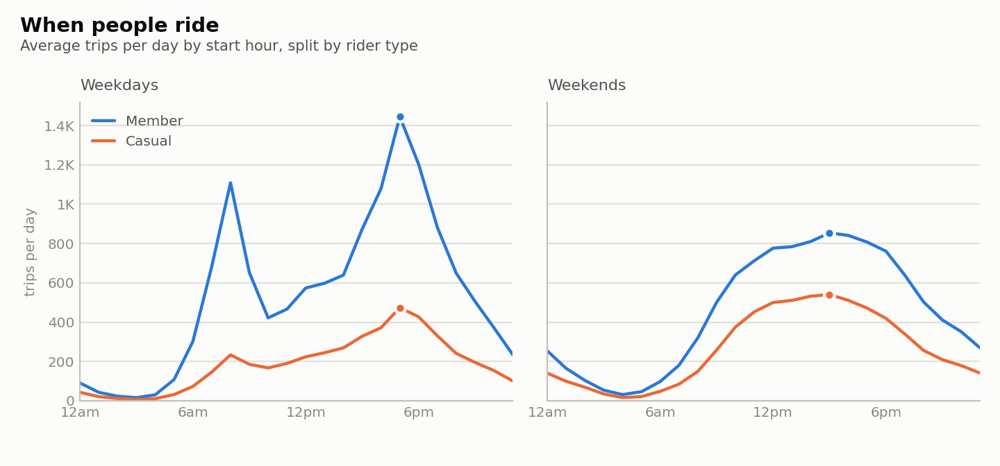
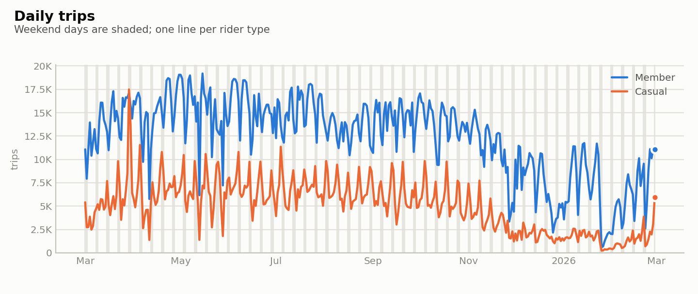
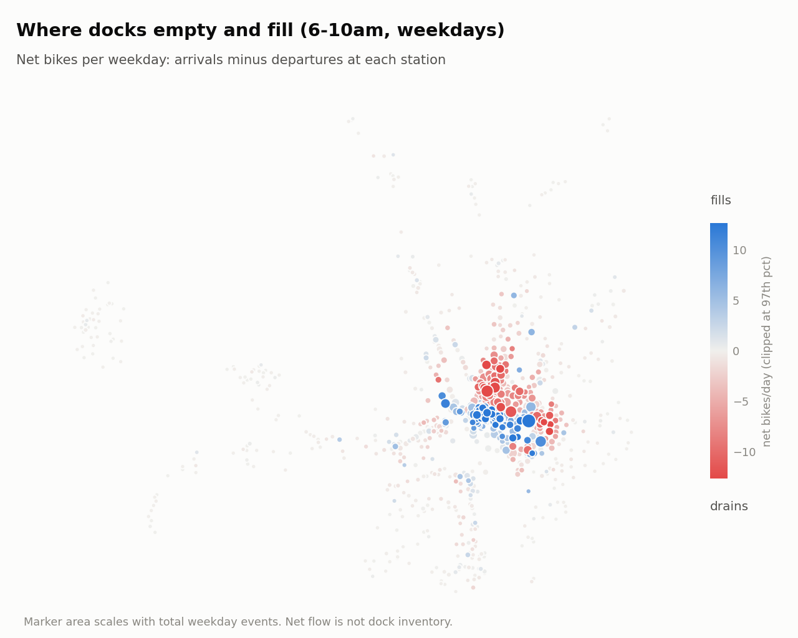

# cabi-analysis

A reproducible SQL and pandas analysis of Capital Bikeshare trip data for the Washington, D.C. area. It downloads the public monthly files, cleans them into a SQLite database with the cleaning rules written as SQL, and answers four questions: when members and casual riders ride, how long they ride, which stations drain or fill during the commute, and how much of the data a dock-based analysis can actually see.



*Average trips per day by start hour, March 2025 to February 2026.*

## What twelve months of data shows

These numbers come from `cabi analyze` on March 2025 through February 2026 (6,355,260 trips after cleaning). They describe one year and are not causal.

- About 17,400 trips a day. Members took 71% of them and 63% were on electric bikes.
- Demand is strongly seasonal. June 2025 was the busiest month at about 22,450 trips a day and January 2026 the quietest at about 8,200, a ratio of 2.7 to 1. Casual riders swing the most, from 34% of trips in August to 19% in January.
- Weekday member riding peaks at 8am and 5pm, which looks like commuting. Casual riders have one peak (5pm on weekdays, 3pm on weekends).
- The median ride is 11.8 minutes for casual riders and 8.7 for members. On classic bikes the gap is larger, 15.6 versus 8.4 minutes.
- 7% of casual docked trips end where they started, against 2% for members.
- On weekday mornings the biggest net drain is Lincoln Park / 13th & East Capitol St NE (16.7 bikes a day) and the biggest net gain is 17th & K St NW / Farragut Square (+22.6). 91 stations lose 5 or more bikes on at least half of weekdays.
- 47% of electric-bike trips have an end away from a dock, so station-level analysis sees only the other 53% of e-bike use.
- Cleaning removed 149,677 of about 6.5 million rows (2.3%), nearly all of them rides under a minute.





## Data

Trip files are published by Capital Bikeshare at <https://s3.amazonaws.com/capitalbikeshare-data/index.html>, one zip per month, named `YYYYMM-capitalbikeshare-tripdata.zip`. Use is subject to the [Capital Bikeshare data license agreement](https://capitalbikeshare.com/data-license-agreement). Raw data is not stored in this repository (`data/` is git-ignored); `cabi download` fetches it.

Things about the files that shaped the design:

- A file holds the rides that **ended** in that month, so rides can start in the previous month.
- Timestamps are local Eastern time with no zone.
- Dockless e-bike trips have empty station fields and coordinates rounded to two decimals (about 1 km). Docked trips carry the bike's GPS position, which for a classic bike is the dock itself.
- Some rides last under a minute, and unreturned bikes show up as rides of about 25 hours with no end coordinates.

## Install and run

```bash
python -m pip install -e ".[dev]"
cabi download 2025-03 2026-02          # about 12 monthly zips into data/
cabi load data/*.zip                   # clean and load into data/cabi.db
cabi analyze                           # figures, CSVs and findings.md in reports/
cabi quality                           # rows removed, by reason
python -m pytest -q
```

Python 3.9 or newer and pandas 2 or 3. A missing month (for example one not yet published) is reported and the rest still download.

## How it works

1. **Load.** The CSV is streamed with the standard library into a temporary staging table. One SQL `CASE` classifies each row by the first rule it breaks: missing id, duplicate id, bad timestamp, unknown rider type, ended before started, under 60 seconds, over 24 hours, missing coordinates, outside the service area. Clean rows go into `trips`, whose `CHECK` constraints repeat the rules so bad data cannot get in by another route. Rejected rows are kept in `rejected_trips` with the reason, so nothing disappears silently. Reloading a file replaces its earlier rows.
2. **Stations.** Each station's location is the most common start or end coordinate among its docked trips (a window function over counts), because a trip's coordinate is the bike's GPS fix, not the dock.
3. **Analyses.** Plain SQL files in `src/cabi/sql/`: hourly and daily volume, SQL medians for duration, round trips, docked versus dockless, and station flow. Station flow counts each departure as -1 and each arrival as +1 inside the 6-10am and 4-8pm weekday windows, then averages over all weekdays so quiet days count as zero.
4. **Report.** pandas shapes the results, matplotlib draws the figures, and `findings.md` is generated from the tables so the sentences cannot disagree with the numbers.

## Testing

The tests build small CSV and zip files in the real file layout, including the quirks above, then check the SQL against an independent plain-Python calculation on seeded random trips. A local HTTP server stands in for S3 in the download tests. I also checked the tests by deliberately breaking rules (changing a threshold, the weekday cutoff, the day-of-week mapping) and confirming a test fails each time. CI runs on Python 3.9, 3.12 and 3.13, with pandas 2 and pandas 3.

## Limits

- Net flow is trips only. It is not dock inventory, because the operator moves bikes by truck and dockless e-bikes are not counted.
- Dockless trips are shown only as coarse cells.
- The first and last month are partial at the edges, and the clock change hours are ambiguous in local time.
- Nothing here is causal. Weather, events and closures are not in the data.

## Layout

```
src/cabi/        load.py, download.py, analysis.py, figures.py, findings.py, cli.py
src/cabi/sql/    schema, classification and every analysis query
tests/           synthetic fixtures, a Python oracle, download and CLI tests
docs/images/     figures used in this README
```

MIT licensed.
