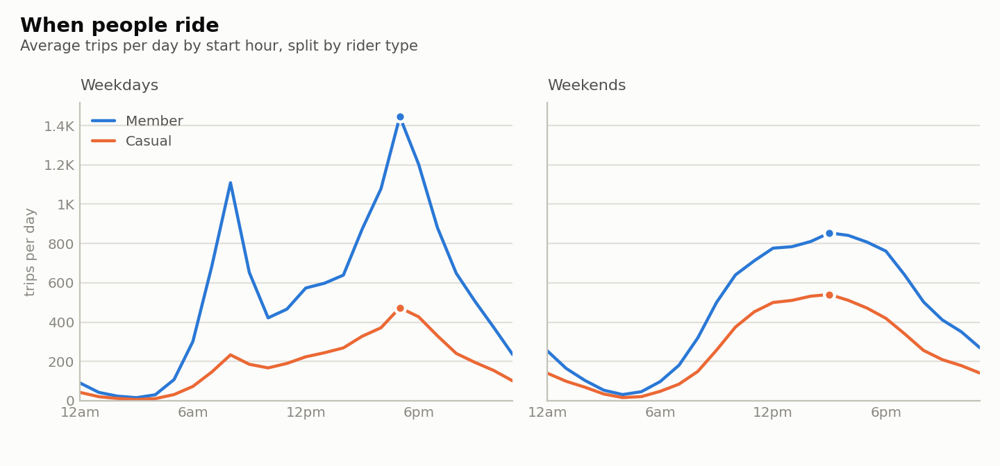
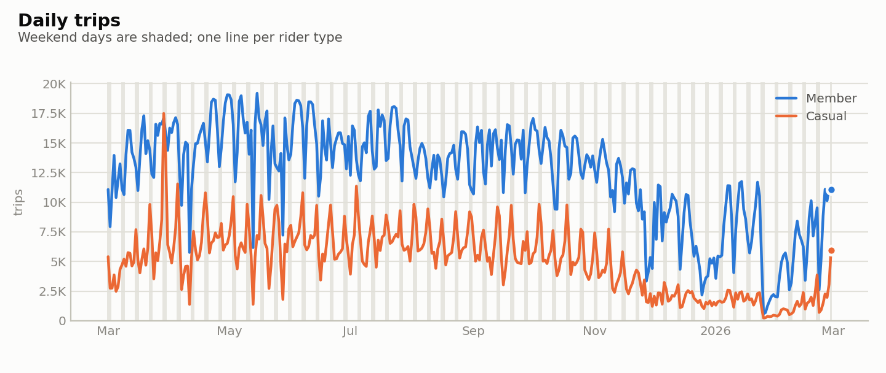
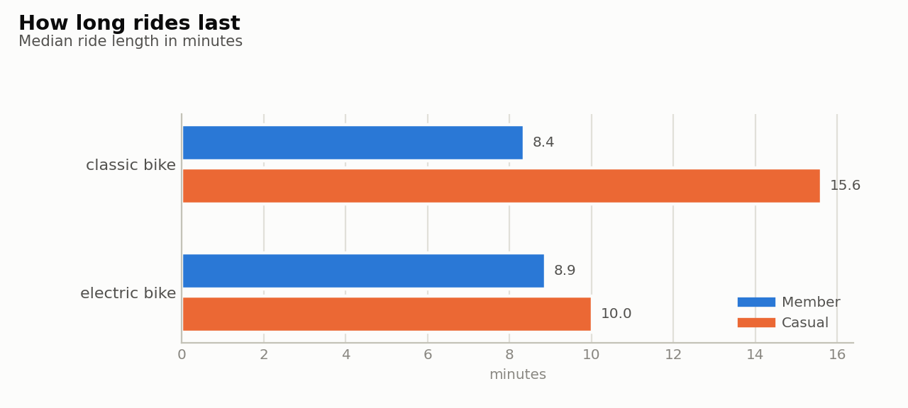
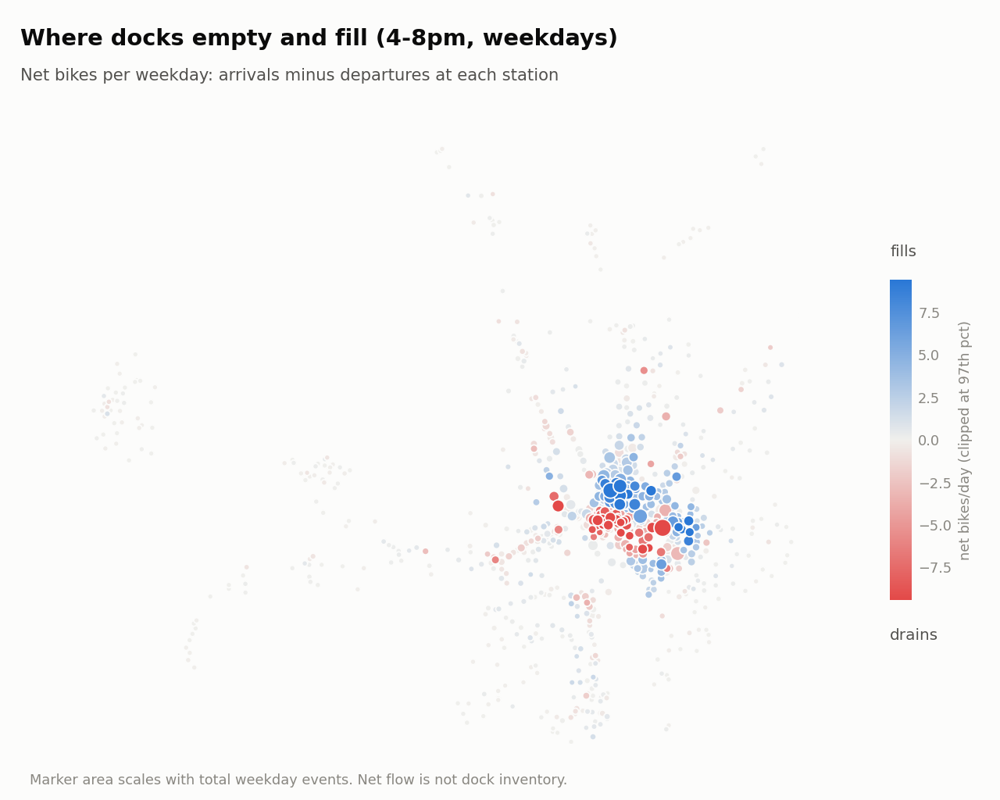
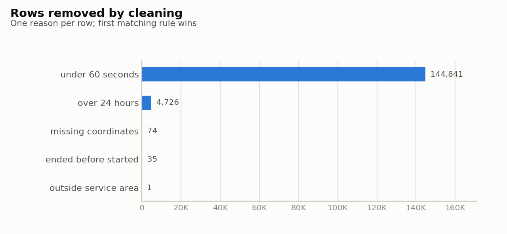

# Findings

Period: 2025-03-01 to 2026-02-28 (12 files, 6,355,352 rows kept after cleaning; rides that started before the first loaded month are excluded from the analysis).

- The cleaned data holds 6,355,260 trips over 365 days (about 17,412 a day). Members took 71% of them, and 63% were on electric bikes.
- Demand swings with the season: 2025-06 is the busiest month at about 22,454 trips a day and 2026-01 the quietest at about 8,217, a ratio of 2.7 to 1. Casual riders are the most seasonal group, making up 34% of trips in 2025-08 against 19% in 2026-01. Weather is not in the data, so this is a pattern and not an explanation.
- Weekday member riding has two peaks, at 8am and 5pm, which looks like commuting. Casual riders peak once, at 5pm on weekdays and 3pm on weekends, and members at 3pm on weekends, a single midday hump. This is an inference from timing, since the data has no trip purpose.
- Median ride length is 11.8 minutes for casual riders and 8.7 for members. On classic bikes the gap widens to 15.6 versus 8.4 minutes.
- Among docked rides, 7% of casual trips and 2% of member trips end at the station they started from.
- On weekday mornings (6-10am) the biggest net drain is Lincoln Park / 13th & East Capitol St NE, which loses 16.7 bikes a day on average, and the biggest net gain is 17th & K St NW / Farragut Square at +22.6. These are net movements of trips, not dock inventory: the operator moves bikes by truck, and dockless e-bikes are not counted. A drain of 5 or more bikes on at least half of weekdays is the rule used to call a station drain-prone; 91 stations meet it in the morning.
- 47% of electric-bike trips have at least one end away from a dock, so dock-based analysis such as station flow sees only the other 53% of e-bike use.
- Cleaning removed 149,677 rows: under 60 seconds (144,841), over 24 hours (4,726), missing coordinates (74), ended before started (35), outside service area (1). That is 2.3% of rows read.

## Figures

## Limits

- Descriptive only: nothing here is causal.
- Start and end dates follow ride end month, so the first and last days can be thin.
- Timestamps are local time without a zone, so the DST changeover hours are ambiguous.
- Dockless coordinates are rounded to about 1 km, so they are only plotted as coarse cells.
